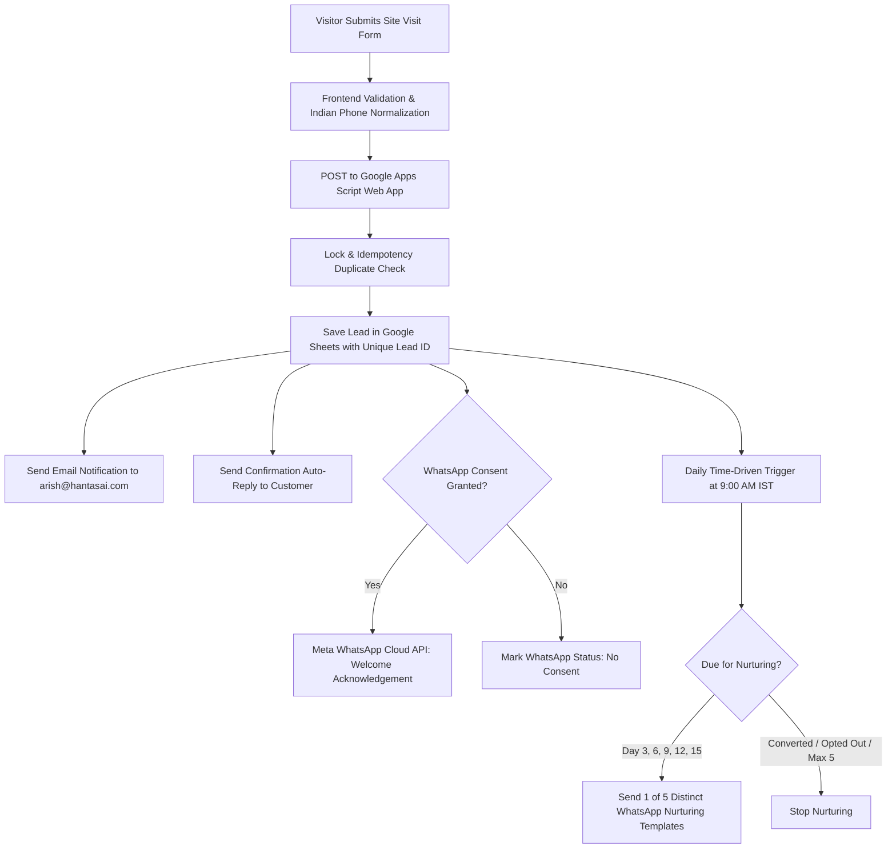

# Hantas Properties — Lead Management & Automated WhatsApp Nurturing Setup Guide

This guide provides simple, step-by-step instructions to set up your complete lead management system using **Google Sheets**, **Google Apps Script**, and the **Meta WhatsApp Cloud API**.

---

## Architecture Overview



---

## Step 1: Create Your Google Sheet

1. Go to [Google Sheets](https://sheets.new) and create a new blank spreadsheet.
2. Rename the spreadsheet at the top left to:  
   **`Hantas Properties - Leads Database`**
3. Rename the first tab at the bottom to:  
   **`Leads`**

---

## Step 2: Open Google Apps Script & Paste Code

1. In your Google Sheet, click **Extensions** in the top menu -> select **Apps Script**.
2. A new tab will open with a code editor showing a file named `Code.gs`.
3. Select everything in the editor and delete it.
4. Open the file [`google-apps-script/Code.gs`](file:///d:/HantasProperties/google-apps-script/Code.gs) in this project, copy the entire code, and paste it into the Apps Script editor.
5. Click the **Save** icon (diskette icon) or press `Ctrl + S`.
6. Name your Apps Script project at the top left:  
   **`Hantas Lead Engine`**

---

## Step 3: Run 1-Click Sheet Initialization

1. At the top of the Apps Script editor, locate the **Run** dropdown menu (which currently might say `doPost` or `myFunction`).
2. Click the dropdown and select **`initializeSheet`**.
3. Click the **Run** button.
4. Google will ask for **Authorization** ("Authorization required"):
   - Click **Review permissions**.
   - Choose your Google account.
   - Click **Advanced** (small link at bottom left).
   - Click **Go to Hantas Lead Engine (unsafe)**.
   - Click **Allow**.
5. Switch back to your Google Sheet tab. You will see that:
   - All **18 Columns** are formatted with a gold and navy luxury theme.
   - The top row is frozen.
   - Data validation dropdowns are added for **Lead Status**, **Vehicle Pick-up Service**, **WhatsApp Consent**, and **Opt-out Status**.

---

## Step 4: Deploy as a Public Web App

To allow your website form to submit leads to Google Sheets, deploy the script as a Web App:

1. In the Apps Script editor, click the blue **Deploy** button (top right) -> select **New deployment**.
2. Click the gear icon next to "Select type" -> choose **Web app**.
3. Fill in the deployment details:
   - **Description**: `Hantas Leads Production v1`
   - **Execute as**: `Me (your email)` *(Important: do not change this)*
   - **Who has access**: `Anyone` *(Crucial so website visitors can submit the form)*
4. Click **Deploy**.
5. Copy the **Web App URL**. It looks like this:  
   `https://script.google.com/macros/s/AKfycbx.../exec`

---

## Step 5: Connect Web App to Your Website

1. In your project workspace, open:  
   [`js/lead-config.js`](file:///d:/HantasProperties/js/lead-config.js)
2. Paste your Web App URL into the `GOOGLE_APPS_SCRIPT_URL` field:
   ```javascript
   window.HANTAS_LEAD_CONFIG = {
     GOOGLE_APPS_SCRIPT_URL: 'https://script.google.com/macros/s/PASTE_YOUR_COPIED_URL_HERE/exec',
     ADMIN_EMAIL: 'arish@hantasai.com',
     ADVISORY_PHONE: '+91 96002 69317',
     DEFAULT_PROJECT: 'Grand Empire (395 Plots @ Manikandam)'
   };
   ```
3. Save the file. That's it! Your landing page forms (`#luxury-inquiry-form` and the VIP Modal `#modal-vip-form`) are now live-connected to Google Sheets.

---

## Step 6: Activate Automated Daily 3-Day Nurturing Trigger

1. In the Apps Script editor, select **`setupDailyTrigger`** from the function dropdown.
2. Click **Run**.
3. In the execution log, you will see:  
   `✓ Successfully scheduled processDailyLeadNurturing to run daily at 9:00 AM IST!`
4. The system will now check every morning for leads due for their 3-day follow-up and nurture them automatically.

---

## Step 7: Meta WhatsApp Cloud API Setup

### A. Create a Meta Developer App (Free)
1. Go to [developers.facebook.com](https://developers.facebook.com) and log in.
2. Click **My Apps** -> **Create App**.
3. Select **Other** -> choose **Business** as the app type -> click **Next**.
4. Set App Name to: `Hantas Properties Lead Advisory`.
5. Under **Add products to your app**, locate **WhatsApp** and click **Set up**.
6. You will be taken to the **API Setup** page where Meta gives you:
   - **Temporary Access Token** (or Permanent System User Token)
   - **Phone Number ID** (e.g. `102938475612345`)
   - **WhatsApp Business Account ID**

### B. Store Secrets Securely in Google Apps Script
1. In your Apps Script editor, click **Project Settings** (gear icon on the left sidebar).
2. Scroll down to **Script Properties** -> click **Edit script properties** -> click **Add script property**.
3. Add the following keys:
   | Property Key | Value | Description |
   | :--- | :--- | :--- |
   | `WHATSAPP_ACCESS_TOKEN` | `EAAB...` | Your Meta Cloud API Access Token |
   | `WHATSAPP_PHONE_NUMBER_ID` | `102938475...` | Your WhatsApp Business Phone Number ID |
   | `WHATSAPP_VERIFY_TOKEN` | `hantas_webhook_secret_2026` | Webhook verification token |
   | `WHATSAPP_TEST_MODE` | `false` | Set to `true` to test without sending live messages |
4. Click **Save script properties**.

> [!NOTE]
> **Graceful Unconfigured Fallback**: If you do not yet have a Meta WhatsApp API token, Google Sheets saving and Email notifications will still work 100%. The system will mark the WhatsApp column as `Config Required (API Token Missing)` rather than failing or faking delivery.

---

## Step 8: Approved Meta WhatsApp Message Templates

Meta requires message templates for business-initiated conversations. Create these 6 templates in your **WhatsApp Manager -> Message Templates**:

### 1. Welcome Acknowledgement (`hantas_site_visit_acknowledgement`)
- **Category**: `UTILITY`
- **Language**: `English (en)`
- **Body**:  
  `Hi {{1}}, thank you for your interest in {{2}}. We have received your site visit request. Our team will contact you to assist with your visit. Thank you for choosing Hantas Properties.`

### 2. Follow-up 1 — Day 3 (`hantas_followup_1`)
- **Category**: `MARKETING`
- **Body**:  
  `Hi {{1}}, this is the Site Advisory Team at Hantas Properties. Following up on your inquiry for {{2}} in Trichy. Would you like to schedule your site visit this week? We offer complimentary vehicle pick-up from Trichy Railway Station, Bus Stand, or Airport at your convenience. Please reply with your preferred day or time!`

### 3. Follow-up 2 — Day 6 (`hantas_followup_2`)
- **Category**: `MARKETING`
- **Body**:  
  `Hello {{1}}, we hope you're having a great week! For {{2}}, our master layout blueprints and DTCP approval documents are ready. North and East facing plots are currently available. Would you like us to share the master blueprint and plot dimension charts with you here on WhatsApp? Reply YES to receive them.`

### 4. Follow-up 3 — Day 9 (`hantas_followup_3`)
- **Category**: `MARKETING`
- **Body**:  
  `Hi {{1}}, regarding {{2}}, our township features 33ft wide blacktop avenues, dedicated park zones, sweet potable ground water, and 24/7 security with rapid connectivity to the Trichy-Madurai NH. Would you like our 2-minute project walkthrough video or brochure? Reply YES to view.`

### 5. Follow-up 4 — Day 12 (`hantas_followup_4`)
- **Category**: `MARKETING`
- **Body**:  
  `Hello {{1}}, many plot buyers at {{2}} take advantage of our hassle-free bank loan assistance with leading nationalized banks (up to 80% loan approval with clear parent document verification). Would you like our advisory team to guide you through loan eligibility or title clearance certificates?`

### 6. Follow-up 5 — Day 15 (`hantas_followup_5`)
- **Category**: `MARKETING`
- **Body**:  
  `Hi {{1}}, this is our final follow-up regarding your site visit request for {{2}}. We want to ensure you find the right property for your family's future. Are you still planning a visit, or would you prefer us to pause updates for now? You can reply anytime or call us directly at +91 96002 69317. Wishing you the best from Hantas Properties!`

---

## Step 9: Testing Checklist

| Checkpoint | Action | Expected Result |
| :--- | :--- | :--- |
| **1. Self-Test in Apps Script** | Run `testFormSubmission()` in Apps Script | Row added to Google Sheet, Admin Email sent to `arish@hantasai.com`, returns `{ success: true, leadId: 'HP-...' }` |
| **2. Website Main Form** | Submit `#luxury-inquiry-form` on landing page | Button shows spinner, returns luxury toast with Lead ID, form clears |
| **3. VIP Modal Form** | Click "Book Free Site Visit" and submit `#modal-vip-form` | Modal closes smoothly after confirmation toast, form resets |
| **4. Phone Normalization** | Enter `9876543210` or `09876543210` | Google Sheet stores `+919876543210` |
| **5. WhatsApp Consent** | Leave checkbox unchecked vs checked | Stored as `NO` (no messages sent) or `YES` (eligible for nurturing) |
| **6. Duplicate Prevention** | Rapidly click submit twice | Button is locked; script cache prevents duplicate sheet rows |
| **7. Email Delivery** | Check inbox at `arish@hantasai.com` | Received branded HTML email with subject: `New Real Estate Lead - [Name] - [Project]` |
| **8. Customer Auto-reply** | Check submitted client email inbox | Received booking summary and advisory contact details |
| **9. Pause & Opt-out** | Change lead status to `Paused`, `Closed`, or `Opted Out` | Nurturing scheduler automatically skips this lead |
| **10. 3-Day Interval** | Inspect `Next Follow-up Date` column | Correctly set to current date + 3 days in `Asia/Kolkata` timezone |
